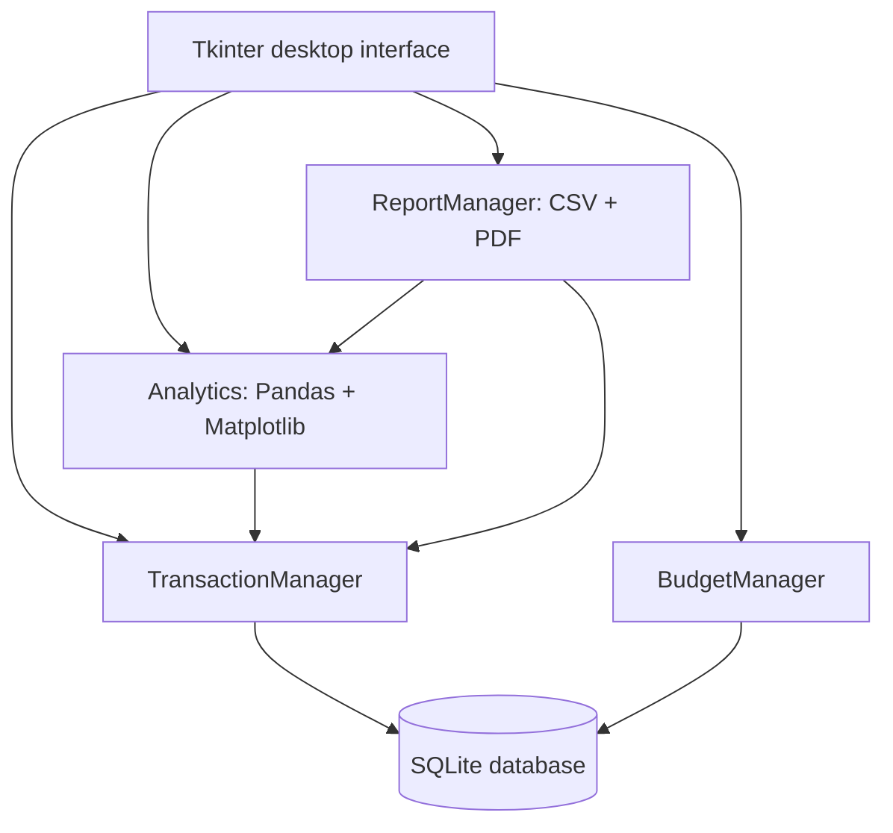

# Personal Expense Tracker with Analytics

An offline, single-user Python desktop mini-project for MCA students. It uses Tkinter/ttk, SQLite, Pandas, Matplotlib and ReportLab. It contains no AI, ML, web server, or external API. No external dataset is required: users enter transactions; an optional CSV supplies demonstration records.

## Architecture — start here



The interface collects input and displays results. Manager classes validate and process requests. SQLite persists records; Pandas groups saved records; Matplotlib draws those groups. Reports reuse the same transaction and analytics logic, keeping calculations consistent.

## Folder structure

```text
expense_tracker/
    main.py
    requirements.txt
    README.md
    sample_transactions.csv
    tracker/
        __init__.py
        schema.sql
        database.py
        validation.py
        transactions.py
        budgets.py
        analytics.py
        reports.py
        gui.py
    data/
        expenses.db
    docs/
        DEVELOPMENT_GUIDE.md
        DIAGRAMS.md
        TESTING.md
        VIVA.md
    tests/
        test_tracker.py
```

`data/app.log` is created at runtime for errors. `expenses.db` is initialized with categories but no transactions. Sample transactions are deliberately separate so your own records start clean.

## Database design

| Table | Main fields | Purpose |
|---|---|---|
| categories | id PK, name, type | Separate income and expense categories; unique name/type pair |
| transactions | id PK, type, amount_paise, category_id FK, date, description, payment_method | Income and expense history |
| budgets | id PK, month, category_id nullable FK, amount_paise | One overall or category limit per month |

Amounts use integer paise: ₹125.50 is stored as `12550`. This avoids binary floating-point errors in saved money and totals. Input parsing uses `Decimal`; charts convert aggregated paise to rupees only for display. SQL has positive amount constraints, foreign keys, allowed types, and indexes. The composite transaction foreign key requires the category type to match the transaction type. Dates have SQL format checks and Python calendar validation; application/service methods are the supported write path. Budget months are also validated in Python.

A NULL budget category means the overall monthly limit. The unique expression index treats NULL as one overall scope so duplicate monthly overall budgets cannot be created. Category IDs generated by this application begin at 1. Category budgets are independent limits, not amounts added to the overall budget.

Full executable CREATE TABLE, index and trigger statements are in `tracker/schema.sql`.

## Phase 1 implementation: initialize SQLite

This phase uses only the Python standard library. From the extracted project folder:

```bat
py -3.11 main.py --init-db
```

`Database` creates the data directory, opens the file, enables foreign keys, reads `schema.sql`, and inserts default categories only if missing. Re-running initialization preserves existing records.

```python
from pathlib import Path
from tracker.database import Database

# The class owns the connection and creates the schema.
db = Database(Path('data') / 'practice.db')
try:
    rows = db.connection.execute(
        'SELECT name, type FROM categories ORDER BY type, name'
    ).fetchall()
    for row in rows:
        print(row['name'], row['type'])
finally:
    db.close()
```

The complete implementation is in `tracker/database.py`; this is an executable usage example. See `docs/DEVELOPMENT_GUIDE.md` for every phase and intermediate-level examples.

## Windows installation and execution

Install 64-bit Python 3.11 or newer with Tcl/Tk support and the Python launcher. Extract this ZIP before running it. Open Command Prompt inside `expense_tracker`:

```bat
py -3.11 -m venv .venv
.venv\Scripts\activate
python -m pip install --upgrade pip
python -m pip install -r requirements.txt
python -m tkinter
python main.py
```

Close the Tk test window before the last command. If you have a newer Python instead of 3.11, replace `py -3.11` with `py`.

PowerShell can run without activation:

```powershell
py -3.11 -m venv .venv
.\.venv\Scripts\python.exe -m pip install -r requirements.txt
.\.venv\Scripts\python.exe main.py
```

Do not install `tkinter`, `sqlite3`, `csv`, `datetime`, `pathlib` or `os` through pip: these are standard-library modules. Internet is needed to install dependencies; normal application use is offline. The code uses no API keys. On Linux, the OS may require its `python3-tk` package and a graphical desktop.

The default database path is relative to `main.py`, not the terminal's current directory. You may choose another file:

```bat
python main.py --db "D:\MyFinance\expenses.db"
```

Store the project/database in a writable folder. Close the app and copy the database file to back it up. CSV exports contain transactions, not budgets; copying the database retains everything.

## First use and sample data

1. Open Reports, choose Import CSV, and select `sample_transactions.csv`.
2. Confirm import. The sample contains 20 fictitious transactions from August–October 2026.
3. Open History to search, filter, sort, edit or delete them.
4. Open Budgets. Enter `2026-10`, Overall monthly budget, and `18000`, then Save.
5. Add a Food category budget of `3000` for that month.
6. View Analytics; blank date fields include every month. Reports default to the current month; enter `2026-08-01` through `2026-10-31` for the entire sample.

Dashboard monthly figures follow your computer's current calendar month, so older sample records will not appear as current-month spending. History and Analytics still show them. You can change CSV dates before importing. Import only once unless you intentionally want duplicate transactions.

## Features and behavior

- Dashboard: all-time income, expenses and net balance; current-month spending, budget, remaining amount, utilization and recent transactions.
- Transactions: add/edit/delete, required fields, strict calendar dates, positive two-decimal money, description search, date/type/category filters, date/amount sorting.
- Categories: built-in categories and custom income/expense categories. Other exists for both types.
- Budgets: set/update/delete monthly and category limits, warning at 80% including 100%, over-budget above 100%, negative remaining amount when overspent. No rollover.
- Analytics: five selectable charts embedded with FigureCanvasTkAgg; missing months inside the data span are filled with zero; empty datasets have a clear message.
- Reports: inclusive date range, monthly summaries, category totals, totals and detailed PDF transaction table; CSV export/import.
- PDF amounts use `INR` for compatibility with the built-in PDF font. GUI amounts use ₹. User-entered non-Latin characters may not render in the default PDF fonts; CSV retains Unicode text.

Available balance means recorded income minus recorded expenses. There is no bank connection or account reconciliation. Future valid dates are allowed and included according to the selected period. All payment methods are treated as cash-flow labels; credit-card settlement and double-entry accounting are outside this mini-project.

## CSV format

UTF-8 (with or without BOM), comma-delimited, exact header order:

```csv
type,amount,category,date,description,payment_method
expense,125.50,Food,2026-10-27,Lunch,UPI
income,35000.00,Salary,2026-10-01,Monthly salary,Bank Transfer
```

Types are income/expense. Payment methods: Cash, UPI, Debit Card, Credit Card, Bank Transfer, Other. Categories must already exist for that type; add custom ones before import. IDs are generated locally and are not imported. Invalid rows show their row number and roll back the whole import. Empty files and wrong headers are rejected. Re-imports append duplicate records. CSV exports preserve the original description, including text that spreadsheet programs may interpret as formulas; import such text columns as Text when opening files in spreadsheet software.

## Module guide

| Module | Responsibility |
|---|---|
| main.py | CLI options, logging, object composition, application startup |
| database.py | SQLite connection, schema execution, default categories |
| validation.py | Decimal-to-paise conversion, dates, date ranges and currency display |
| transactions.py | Category creation/listing, CRUD, parameterized filters and allowed sorting |
| budgets.py | Set/update/delete limits; monthly spending and threshold calculations |
| analytics.py | DataFrames, grouped sums, month-gap filling and figures |
| reports.py | Atomic CSV import, CSV export, text summaries and paginated PDFs |
| gui.py | Sidebar, pages, forms, Treeviews, dialogs and chart embedding |
| tests/test_tracker.py | Business rule and integration tests using temporary databases |

## Testing and documentation

```bat
python -m unittest discover -s tests -v
python -m compileall -q main.py tracker tests
```

Read `docs/TESTING.md` for expected sample totals and GUI checks. `docs/DIAGRAMS.md` contains the ER, architecture and data-flow diagrams. `docs/VIVA.md` contains questions and answers.

This delivery passed 14 automated tests in the build environment, including drawing all five chart types with empty and populated data, persistence, CSV rollback and PDF creation. The Tkinter GUI was compiled and import-checked, but could not be opened in the build environment because no graphical display was available. Run the included Windows GUI checklist before your demonstration.
